# Hermes Finance Stack

[](https://nestjs.com/)
[](https://www.postgresql.org/)
[](https://docs.docker.com/compose/)
[](https://modelcontextprotocol.io/)
[](https://vitest.dev/)

> **Read in English:** [README.md](README.md) · **Operación y Migraciones:** [docs/DEPLOYMENT.md](docs/DEPLOYMENT.md) · **Changelog:** [CHANGELOG.md](CHANGELOG.md)

Plataforma self-hosted de finanzas personales, del hogar y salidas grupales operada íntegramente desde Telegram. Combina **NousResearch Hermes Agent**, una API modular en **NestJS 12 + TypeORM** con **43 tools MCP Streamable HTTP**, **PostgreSQL 17**, generación nativa de **gráficos PNG** y perfiles opcionales para **Metabase BI** y **Paperless-ngx OCR**.

---

## En Acción (Demo en Telegram)

Un único bot de Telegram atiende chats privados y grupos compartidos con ejecución silenciosa (`👀` → `👍`), confirmaciones estructuradas y salidas optimizadas para celular (sin tablas Markdown rotas):

```text
Vos:   Pagué 889 mil a BBVA con transferencia desde Galicia
Bot:   Listo ✅
       • 📅 23/11/2026  • 🏪 BBVA  • 💰 $889.000 ARS
       • 🏷️ PRESTAMOS_Y_SEGUROS · Variable  • 💳 Transferencia (Galicia)

Vos:   Armá la salida "Asado sábado" con Juan, Sofía y yo.
       Juan pagó 60k de carne y Sofía 30k de vino (el vino solo entre Juan y Sofía).
       ¿Cómo dividimos?
Bot:   🔥 Asado sábado — Total: $90.000
       • Juan: pagó $60.000 | le toca $35.000 (+$25.000)
       • Sofía: pagó $30.000 | le toca $35.000 (-$5.000)
       • Vos: pagó $0 | le toca $20.000 (-$20.000)

       💸 Transferencias mínimas:
       • Vos → Juan: $20.000
       • Sofía → Juan: $5.000

Vos:   Mandame un gráfico de gastos por categoría de este mes
Bot:   [Envía gráfico PNG 800×480 directamente en Telegram]
```

*(También procesa capturas bancarias con vista previa/confirmación y boletas PDF digitales o escaneadas con planes en cuotas.)*

---

## Arquitectura

PostgreSQL es la única fuente de verdad (`memory_enabled: false` en Hermes). Toda la lógica de negocio vive en servicios tipados en TypeScript expuestos por MCP Streamable HTTP y controladores REST modulares.

```mermaid
flowchart LR
    TG["Telegram (DM / Grupo)<br/>Texto · Capturas · PDFs"] --> HERMES["Hermes Agent<br/>(Gateway + Visión + anydoc)"]
    HERMES -->|"Streamable HTTP<br/>POST /api/mcp (43 tools)"| API["Backend NestJS 12"]
    HERMES -.->|"MEDIA:/opt/data/{charts,exports}"| TG

    subgraph API_MODS["Núcleo Modular NestJS 12"]
        direction TB
        M1["ExpensesModule<br/>7 Controladores REST + Charts + CSV/JSON"]
        M2["OutingsModule<br/>Salidas Grupales y División"]
        M3["McpModule<br/>7 Registradores por Dominio"]
    end

    API --- API_MODS
    API_MODS --> PG[("PostgreSQL 17<br/>10 Tablas")]

    API_MODS -.->|"--profile paperless (opcional)"| PL["Paperless-ngx<br/>Archivado y OCR"]
    PG -.->|"--profile metabase (opcional)"| MB["Metabase BI<br/>15 Consultas SQL Calibradas"]
```



---

## Capacidades Principales

- **Multi-Usuario y Balances en un Solo Hermes**: Un único bot identifica automáticamente quién escribe (`**User:**` en DM, `[remitente]` en grupo), separa gastos `PERSONAL` vs `SHARED` con porcentajes configurables y calcula liquidaciones mínimas del hogar.
- **Salidas y Eventos Compartidos (`outings`)**: Control tipo Splitwise aislado de tu cashflow personal. Funciona con varios usuarios o con un solo usuario dictando lo que gastó cada amigo (sin exigirles Telegram), con división equitativa, por subconjunto (`splitBetween`), exacta o porcentual, y opción de registrar tu parte en gastos personales al cerrar.
- **Gastos Fijos / Recurrentes**: Plantillas mensuales, bimestrales o anuales (`recurring_expenses`) para consultar qué falta pagar o venció en el mes y registrar el pago ajustando el monto real por inflación.
- **Cuotas y Extensiones de Tarjeta**: Planes en cuotas con recálculo automático padre/hijo, días de cierre y vencimiento, y agrupación por titular de extensión (marcando con `🏁` la última cuota).
- **Presupuestos por Categoría y Alertas**: Topes mensuales por rubro/alcance con umbrales configurables integrados automáticamente en los resúmenes.
- **Comprobantes Multimodales, Gráficos PNG y Exportación**: Lectura instantánea de PDFs digitales (`read_file`), vista previa por visión en capturas sin texto, gráficos PNG 800×480 (`@resvg/resvg-wasm`) y exportación CSV (UTF-8 BOM) / JSON.

---

## Despliegue Rápido

Requiere **Docker Engine + Compose v2**, una **API Key de OpenRouter** (soporta `openrouter/free` a `$0`) y un **Bot Token de Telegram** de `@BotFather`.

```bash
git clone https://github.com/LucasMirandaD/hermes-finance-stack.git
cd hermes-finance-stack
chmod +x scripts/*.sh
./scripts/setup.sh
```

O directamente con Docker Compose:

```bash
cp .env.example .env    # Completá OPENROUTER_API_KEY, TELEGRAM_BOT_TOKEN y EXPENSES_DB_PASSWORD
docker compose up -d --build
./scripts/smoke-test.sh
```

### Perfiles Modulares de Docker

Levantá solo los servicios que necesites: `health_check` detecta los perfiles opcionales deshabilitados de forma limpia (`status: "disabled"`):

| Perfil | Comando | Servicios Incluidos |
|---|---|---|
| **Base** | `docker compose up -d --build` | PostgreSQL 17, API/MCP NestJS 12 (`:3000`), Hermes Agent |
| **BI** | `docker compose --profile metabase up -d --build` | Base + Metabase (`:3005`, 15 consultas en [`docs/metabase-queries.sql`](docs/metabase-queries.sql)) |
| **Docs/OCR** | `docker compose --profile paperless up -d --build` | Base + Paperless-ngx (`:8010`) + Redis |
| **Completo** | `docker compose --profile full up -d --build` | Todos los servicios combinados |

Pairing inicial en Telegram (si `TELEGRAM_ALLOWED_USERS` quedó vacío): escribile al bot, aprobá el código con `docker exec hermes-agent hermes pairing approve telegram <CODIGO>`, y luego mandale **"Empecemos"** para ejecutar el onboarding conversacional.

---

## Referencia Técnica (API y MCP)

<details>
<summary><strong>43 Tools MCP (POST /api/mcp)</strong></summary>

| Dominio | Tools |
|---|---|
| **Core y Salud (7)** | `health_check`, `register_expense`, `search_expenses`, `list_recent_expenses`, `update_expense`, `delete_expense`, `extract_scanned_pdf_ocr` |
| **Cuotas y Tarjetas (8)** | `get_upcoming_installments`, `get_monthly_installments_summary`, `search_pending_installments`, `pay_installment`, `update_installment`, `delete_installment`, `list_credit_cards`, `register_credit_card` |
| **Miembros y Compartidos (5)** | `create_member`, `update_member`, `list_members`, `delete_member`, `get_shared_balance` |
| **Salidas / Eventos (8)** | `create_outing`, `list_outings`, `add_outing_participant`, `add_outing_expense`, `delete_outing_expense`, `get_outing_balance`, `settle_outing`, `delete_outing` |
| **Presupuestos (4)** | `set_category_budget`, `list_category_budgets`, `delete_category_budget`, `get_budget_status` |
| **Gastos Fijos / Recurrentes (6)** | `create_recurring_expense`, `list_recurring_expenses`, `update_recurring_expense`, `delete_recurring_expense`, `get_fixed_expenses_status`, `pay_recurring_expense` |
| **Analítica, Gráficos y Export (5)** | `get_financial_summary`, `compare_months`, `top_expenses`, `export_expenses`, `render_chart` |

</details>

<details>
<summary><strong>Controladores REST Modulares (/api)</strong></summary>

- `GET /api/health` (`AppController`)
- `/api/expenses` — `POST`, `GET`, `GET /search`, `GET|PATCH|DELETE /:id`
- `/api/installments` — `GET /upcoming`, `GET /summary`, `GET /pending`, `POST /:id/pay`, `PATCH|DELETE /:id`
- `/api/credit-cards` — `GET`, `POST`
- `/api/members` — `GET`, `POST`, `GET /shared/balance`, `PATCH|DELETE /:ref`
- `/api/budgets` — `GET`, `POST`, `GET /status`, `DELETE /:id`
- `/api/recurring-expenses` — `GET`, `POST`, `GET /status`, `POST /:ref/pay`, `PATCH|DELETE /:id`
- `/api/analytics` — `GET /summary`, `GET /compare`, `GET /top`, `GET /export`, `GET /charts/render`
- `/api/outings` — `POST`, `GET`, `GET /:ref/balance`, `POST /:ref/participants`, `POST /:ref/expenses`, `DELETE /expenses/:expenseId`, `POST /:ref/settle`, `DELETE /:ref`

</details>

<details>
<summary><strong>Estructura y Desarrollo Local</strong></summary>

```text
hermes-finance-stack/
├── docker-compose.yml               # Base + perfiles opcionales metabase, paperless, full
├── backend/                         # NestJS 12 Clean Architecture (Expenses, Outings, MCP)
│   ├── sql/                         # Migraciones SQL idempotentes (001, 002)
│   └── src/modules/{expenses,outings,mcp}/
├── hermes/                          # Configuración declarativa, SOUL.md y skills/finanzas/
├── docs/                            # DEPLOYMENT.md, metabase-queries.sql, releases/
└── scripts/                         # setup.sh, migrate.sh, smoke-test.sh
```

```bash
cd backend
pnpm install
pnpm test      # 38 tests unitarios con Vitest en 9 suites
pnpm build
```

</details>

<details>
<summary><strong>Resolución Rápida de Problemas</strong></summary>

- **OpenRouter `openrouter/free` devuelve 404**: Habilitá endpoints `:free` en [OpenRouter Guardrails](https://openrouter.ai/workspaces/default/guardrails).
- **Actualización desde v1.x con `DB_SYNCHRONIZE=false`**: Ejecutá `./scripts/migrate.sh --normalize-categories --backfill-owner "TuNombre"` (hace backup automático `pg_dump` previo).
- **Permisos `EACCES` en gráficos o exports**: Verificá que `hermes/charts` y `hermes/exports` tengan dueño `1000:1000` (`HERMES_UID:HERMES_GID`).
- **Guía operativa completa**: Consultá [docs/DEPLOYMENT.md](docs/DEPLOYMENT.md).

</details>
