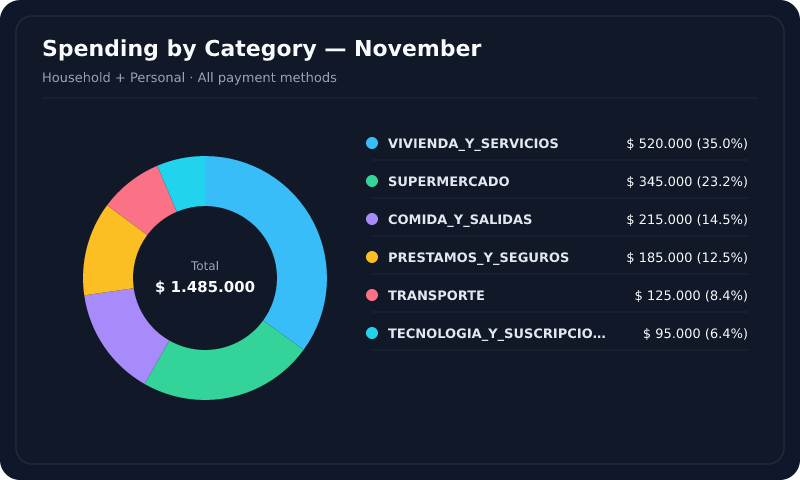
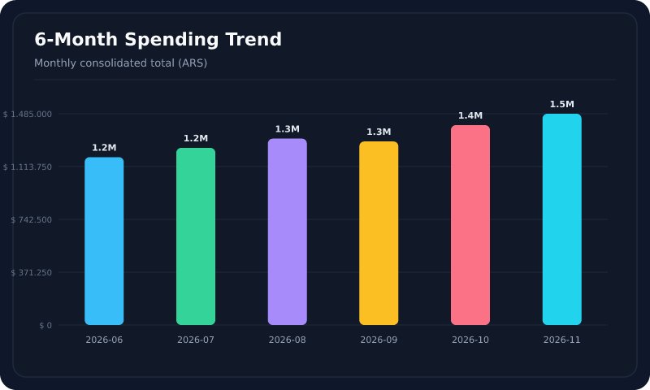
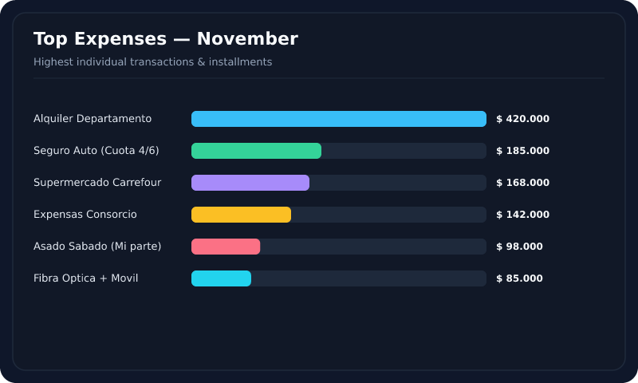
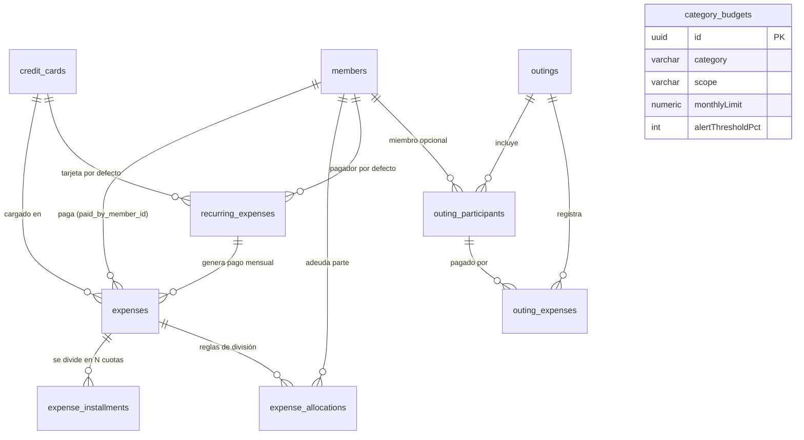

# Hermes Finance Stack

[](https://nestjs.com/)
[](https://www.postgresql.org/)
[](https://typeorm.io/)
[](https://docs.docker.com/compose/)
[](https://modelcontextprotocol.io/)
[](https://vitest.dev/)

> **Idioma / Language:** [English (README.md)](README.md) · Español  
> **Operación y Upgrades:** [docs/DEPLOYMENT.md](docs/DEPLOYMENT.md) · **Changelog:** [CHANGELOG.md](CHANGELOG.md) · **Último Release:** [v2.0.1](docs/releases/v2.0.1.md)

**Plataforma self-hosted de finanzas personales, del hogar y salidas grupales operada íntegramente desde Telegram.**  
Construida sobre **NousResearch Hermes Agent**, una API modular con Clean Architecture en **NestJS 12 + TypeORM** que expone **43 tools MCP Streamable HTTP**, **PostgreSQL 18**, renderizado nativo de **gráficos PNG 800×480** (`@resvg/resvg-wasm`) y perfiles opcionales de **Metabase BI** y **Paperless-ngx OCR**.

[Por qué este stack](#por-qué-este-stack) · [Capacidades](#capacidades) · [Escenarios en Telegram](#escenarios-reales-en-telegram) · [Gráficos PNG](#gráficos-png-nativos) · [Arquitectura y Modelo de Datos](#arquitectura-y-modelo-de-datos) · [Instalación](#instalación-y-puesta-en-marcha) · [Modelos LLM y Costos](#modelos-llm-y-costos) · [Seguridad](#seguridad-y-privacidad) · [Referencia API y MCP](#referencia-completa-api-y-mcp)

---

## Por qué este stack

La mayoría de los bots conversacionales de gastos dependen de la memoria del LLM, archivos planos o planillas—que se rompen en cuanto aparecen cuotas de tarjetas, extensiones, gastos compartidos en pareja o impuestos fijos que cambian por inflación.

**Hermes Finance Stack** separa la **comprensión en lenguaje natural** de la **contabilidad financiera**:

| Principio de diseño | Cómo funciona |
|---|---|
| **PostgreSQL 18 como única fuente de verdad** | Hermes opera con `memory_enabled: false`. Cada alta, consulta, saldo y liquidación impacta tablas relacionales tipadas en PostgreSQL 18—sin alucinaciones ni gastos "olvidados". |
| **Matemática financiera determinística** | Planes de cuotas, agrupación por titular/extensión, prorrateos del hogar y transferencias mínimas en salidas se calculan en servicios TypeScript con tests unitarios, nunca con aritmética del LLM. |
| **Un solo bot, múltiples personas** | Una única instancia de Hermes atiende chats 1:1 y grupos familiares en Telegram, identificando automáticamente a cada integrante (`**Usuario:**` en DM, `[remitente]` en grupos). |
| **Salidas grupales aisladas** | Viajes, cenas y asados viven en su propio dominio (`OutingsModule`) para no contaminar la contabilidad del hogar, con liquidación en un paso y registro opcional de *tu* parte como gasto personal. |
| **Perfiles Docker modulares** | Levantá solo el núcleo liviano de 3 contenedores (`postgres`, `expenses-api`, `hermes-agent`), o activá `--profile metabase`, `--profile paperless` o `--profile full` solo si los necesitás. |

---

## Capacidades

| Módulo | Qué resuelve |
|---|---|
| **Captura diaria y multimodal** | Texto natural en español/inglés, capturas de transferencias bancarias (vista previa por Vision + confirmación), PDFs digitales (`read_file`) y PDFs escaneados (OCR opcional vía Paperless-ngx). |
| **Tarjetas, cuotas y extensiones** | Planes de cuotas con recálculo automático padre/hijos, fechas de cierre y vencimiento, marca `🏁` en última cuota y agrupación diferenciada por titular vs tarjeta extensión. |
| **Multiusuario y saldos del hogar** | Alcances `PERSONAL` y `SHARED`, asignaciones por porcentaje personalizado (`expense_allocations`) y cálculo de transferencias mínimas para saldar el mes. |
| **Salidas grupales ("Salidas")** | Seguimiento tipo Splitwise manejado entre varios usuarios *o* dictado por una sola persona para amigos ad-hoc. Soporta división equitativa, por subconjunto (`splitBetween`), montos exactos o porcentajes. |
| **Gastos fijos y recurrentes** | Plantillas mensuales, bimestrales o anuales (`recurring_expenses`) con control de *"¿qué falta pagar este mes?"* y ajuste del monto real al pagar (ideal para inflación). |
| **Presupuestos por categoría y alertas** | Topes mensuales por categoría y alcance (`PERSONAL`, `SHARED`, `ALL`) con umbrales configurables que se muestran automáticamente en los resúmenes. |
| **Gráficos PNG nativos y exportación** | Renderizado SVG → PNG en servidor (`@resvg/resvg-wasm`, 800×480 en paleta Slate oscura) enviado directo a Telegram vía `MEDIA:`, más exportación CSV UTF-8 BOM (listo para Excel) y JSON. |
| **BI y archivo documental opcional** | 15 queries SQL calibradas para **Metabase** ([`docs/metabase-queries.sql`](docs/metabase-queries.sql)) y archivado/OCR asíncrono con **Paperless-ngx**. |

---

## Escenarios reales en Telegram

El bot trabaja con **ejecución silenciosa de tools** (`👀` mientras procesa → `👍` al terminar) y formato mobile-first sin tablas Markdown rotas en pantalla chica.

### 1. Gasto diario y transferencias bancarias
```text
Vos:   Pagué 889 mil a BBVA con transferencia desde Galicia
Bot:   Listo ✅
       • 📅 23/11/2026  • 🏪 BBVA  • 💰 $889.000 ARS
       • 🏷️ PRESTAMOS_Y_SEGUROS · Variable  • 💳 Transferencia (Galicia)
```

### 2. Cuotas con tarjeta de crédito y extensiones
```text
Vos:   Compré una notebook en 6 cuotas de 185k con la Visa Galicia (extensión de Sofía)
Bot:   Registrado ✅ (6 cuotas generadas)
       • 🏪 Notebook · 💰 $1.110.000 ($185.000 × 6)
       • 💳 Visa Galicia (Extensión: Sofía) · Primera cuota: Dic 2026
       • 🏁 Última cuota programada: May 2027
```

### 3. Salidas grupales con división por subconjunto
```text
Vos:   Armá la salida "Asado sábado" con Juan, Sofía y yo.
       Juan pagó 60k de carne y Sofía 30k de vino (el vino solo entre Juan y Sofía).
       ¿Cómo dividimos?
Bot:   🔥 Asado sábado — Total: $90.000
       • Juan: pagó $60.000 | le toca $35.000 (+$25.000)
       • Sofía: pagó $30.000 | le toca $35.000 (-$5.000)
       • Vos: pagó $0 | le toca $20.000 (-$20.000)

       💸 Transferencias mínimas:
       • Vos → Juan: $20.000
       • Sofía → Juan: $5.000

Vos:   Cerrá la salida y anotá mi parte en mis gastos
Bot:   Salida cerrada ✅ Se registró tu parte ($20.000) en COMIDA_Y_SALIDAS.
```

### 4. Gastos fijos / recurrentes con ajuste por inflación
```text
Vos:   ¿Qué fijos faltan pagar este mes?
Bot:   📌 Gastos fijos pendientes (Noviembre):
       • Alquiler — est. $420.000 (vence día 10)
       • Fibra Óptica — est. $85.000 (vence día 18)

Vos:   Ya pagué Fibra Óptica, vino 92k con débito
Bot:   Pagado ✅ Fibra Óptica registrada por $92.000 (+8,2% vs estimado).
```

### 5. Presupuestos, resúmenes y exportación CSV
```text
Vos:   ¿Cómo vengo este mes con los presupuestos? Exportame el detalle en CSV
Bot:   📊 Resumen Noviembre — Total: $1.485.000
       • SUPERMERCADO: $345.000 / $350.000 (98,6% ⚠️ cerca del tope)
       • COMIDA_Y_SALIDAS: $215.000 / $200.000 (107,5% 🚨 excedido)
       [Adjunta expenses-2026-11.csv directo en Telegram]
```

### 6. Capturas de comprobantes y facturas PDF
- **Foto de ticket / transferencia (sin texto)**: Hermes extrae comercio, fecha, monto y medio de pago por Vision y devuelve una vista previa estructurada pidiendo confirmación antes de grabar.
- **PDF digital**: Lectura instantánea con `read_file`.
- **PDF escaneado**: Fallback automático a `extract_scanned_pdf_ocr` cuando está activo `--profile paperless`.

---

## Gráficos PNG nativos

Los gráficos se generan dentro de `expenses-api` usando `@resvg/resvg-wasm` (sin Chrome headless, sin Puppeteer y sin APIs externas) y se envían directo a Telegram:

| Gastos por categoría (`by_category`) | Evolución de 6 meses (`monthly_trend`) |
|---|---|
|  |  |

| Mayores gastos (`top_expenses`) | Otros tipos soportados |
|---|---|
|  | • `fixed_vs_variable` (proporción Fijos vs Variables)<br/>• `by_holder` (gastos agrupados por titular / extensión)<br/>• Períodos y monedas configurables (`ARS`, `USD`, etc.) |

---

## Arquitectura y Modelo de Datos

### Topología del sistema

```mermaid
flowchart LR
    TG["Telegram (DM / Grupo)<br/>Texto · Capturas · PDFs"] --> HERMES["Hermes Agent<br/>(Gateway + Vision + anydoc)"]
    HERMES -->|"Streamable HTTP<br/>POST /api/mcp (43 tools)"| API["Backend NestJS 12"]
    HERMES -.->|"MEDIA:/opt/data/{charts,exports}"| TG

    subgraph API_MODS["Núcleo Modular NestJS 12"]
        direction TB
        M1["ExpensesModule<br/>7 Controladores REST · Charts · CSV/JSON"]
        M2["OutingsModule<br/>Salidas Grupales y Motor de División"]
        M3["McpModule<br/>7 Registradores de Tools por Dominio"]
    end

    API --- API_MODS
    API_MODS --> PG[("PostgreSQL 18<br/>10 Tablas Normalizadas")]

    API_MODS -.->|"--profile paperless (opcional)"| PL["Paperless-ngx<br/>Archivado y OCR"]
    PG -.->|"--profile metabase (opcional)"| MB["Metabase BI<br/>15 Queries SQL Calibradas"]
```



### Esquema PostgreSQL 18 (10 tablas)



### Ciclo de vida de un mensaje
1. El usuario envía texto, foto o PDF en Telegram (DM o Grupo).
2. Hermes Agent carga las skills (`skills/finanzas/{facturas-ocr,monthly-summary-format,onboarding}`) e invoca las tools MCP correspondientes en `POST http://expenses-api:3000/api/mcp`.
3. NestJS valida los datos (`class-validator` / Zod), ejecuta operaciones transaccionales sobre PostgreSQL 18 y, si corresponde, genera gráficos PNG o archivos CSV/JSON en `/opt/data/{charts,exports}`.
4. Hermes responde en Telegram con formato compacto para celular y los adjuntos `MEDIA:`.

---

## Instalación y puesta en marcha

### Requisitos previos
- **Docker Engine** + **Docker Compose v2** (`docker compose version`)
- **API Key de OpenRouter** ([openrouter.ai](https://openrouter.ai/)) — compatible con `openrouter/free` a `$0`
- **Token de bot de Telegram** creado con `@BotFather`

### Opción A — Asistente interactivo (Recomendado)

```bash
git clone https://github.com/LucasMirandaD/hermes-finance-stack.git
cd hermes-finance-stack
chmod +x scripts/*.sh
./scripts/setup.sh
```

El asistente genera `.env`, crea `hermes/{charts,exports}` con permisos `1000:1000`, te permite elegir el perfil de Docker, levanta los servicios y ejecuta el smoke test de punta a punta.

### Opción B — Docker Compose manual

```bash
git clone https://github.com/LucasMirandaD/hermes-finance-stack.git
cd hermes-finance-stack
mkdir -p hermes/charts hermes/exports
chown -R 1000:1000 hermes/charts hermes/exports 2>/dev/null || true

cp .env.example .env
# Editá .env: completá OPENROUTER_API_KEY, TELEGRAM_BOT_TOKEN y EXPENSES_DB_PASSWORD

docker compose up -d --build
./scripts/smoke-test.sh
```

### Perfiles Docker modulares

Elegí solo los servicios que necesites. `health_check` informa automáticamente los perfiles opcionales apagados como `{ "enabled": false, "status": "disabled" }`:

| Perfil | Comando | Servicios incluidos y puertos |
|---|---|---|
| **Base** *(por defecto)* | `docker compose up -d --build` | PostgreSQL 18, API/MCP NestJS 12 (`:3000`), Hermes Agent |
| **BI** | `docker compose --profile metabase up -d --build` | Base + Metabase (`:3005`, 15 queries en [`docs/metabase-queries.sql`](docs/metabase-queries.sql)) |
| **Docs / OCR** | `docker compose --profile paperless up -d --build` | Base + Paperless-ngx (`:8010`) + Redis 7 |
| **Full** | `docker compose --profile full up -d --build` | Todos los servicios combinados |

### Vinculación de Telegram y Onboarding guiado

1. Si dejaste `TELEGRAM_ALLOWED_USERS` vacío en `.env`, enviale un mensaje al bot para recibir tu código de vinculación.
2. Aprobalo desde la terminal del servidor:
   ```bash
   docker exec hermes-agent hermes pairing approve telegram <CODIGO>
   ```
3. Escribí **"Empecemos"** en el chat: la skill `onboarding` te guiará paso a paso para cargar miembros del hogar, tarjetas, gastos fijos y presupuestos.

> **¿Actualizás desde v1.x o desde PostgreSQL 17?** Seguí el runbook con backup automático (`pg_dump`) y `./scripts/migrate.sh` en [docs/DEPLOYMENT.md](docs/DEPLOYMENT.md).

---

## Modelos LLM y costos

Hermes Agent se conecta a OpenRouter (`hermes/config.yaml`), permitiéndote cambiar de modelo en cualquier momento sin tocar el backend:

| Nivel | Modelo de ejemplo | Costo estimado | Ideal para |
|---|---|---|---|
| **Gratis** *(por defecto)* | `openrouter/free` | **$0 / mes** | Empezar sin costo, carga diaria por texto y llamadas MCP |
| **Producción económica** | `google/gemini-2.5-flash` / `anthropic/claude-3.5-haiku` | ~$0.50–$2 / mes | Máxima velocidad en tool-calling y lectura confiable de capturas |
| **Alta precisión** | `anthropic/claude-sonnet-4` / `openai/gpt-4.1` | ~$3–$8 / mes | Facturas extensas multi-ítem y grupos con conversaciones largas |

> **Nota sobre `openrouter/free`**: si devuelve HTTP `404`, habilitá modelos `:free` en [OpenRouter Guardrails](https://openrouter.ai/workspaces/default/guardrails).

---

## Seguridad y privacidad

- **Contabilidad 100% self-hosted**: tus gastos, tarjetas, cuotas y saldos viven únicamente en tu volumen local de PostgreSQL 18—sin SaaS de terceros ni credenciales bancarias.
- **Contenedores con privilegios mínimos**: `expenses-api` corre como usuario no-root `node` (`1000:1000`). `./hermes` se monta en solo lectura (`:ro`), limitando la escritura exclusivamente a `./hermes/charts` y `./hermes/exports`.
- **Control de acceso en Telegram**: solo responden usuarios aprobados por pairing o listados por ID numérico en `TELEGRAM_ALLOWED_USERS`.
- **Sin fugas en memoria no estructurada**: Hermes corre con `memory_enabled: false`, evitando que datos financieros sensibles se dupliquen en archivos de memoria planos.
- **Validación estricta de entorno**: el backend falla rápido al arrancar con validación Joi (`backend/src/config/env.schema.ts`) si faltan credenciales requeridas.

---

## Referencia completa API y MCP

### 43 Tools MCP (`POST /api/mcp`)

| Registrador por dominio | Cant. | Tools |
|---|---|---|
| **Core y Salud** | 7 | `health_check`, `register_expense`, `search_expenses`, `list_recent_expenses`, `update_expense`, `delete_expense`, `extract_scanned_pdf_ocr` |
| **Cuotas y Tarjetas** | 8 | `get_upcoming_installments`, `get_monthly_installments_summary`, `search_pending_installments`, `pay_installment`, `update_installment`, `delete_installment`, `list_credit_cards`, `register_credit_card` |
| **Miembros y Compartidos** | 5 | `create_member`, `update_member`, `list_members`, `delete_member`, `get_shared_balance` |
| **Salidas Grupales** | 8 | `create_outing`, `list_outings`, `add_outing_participant`, `add_outing_expense`, `delete_outing_expense`, `get_outing_balance`, `settle_outing`, `delete_outing` |
| **Presupuestos** | 4 | `set_category_budget`, `list_category_budgets`, `delete_category_budget`, `get_budget_status` |
| **Gastos Fijos / Recurrentes** | 6 | `create_recurring_expense`, `list_recurring_expenses`, `update_recurring_expense`, `delete_recurring_expense`, `get_fixed_expenses_status`, `pay_recurring_expense` |
| **Analítica, Gráficos y Export** | 5 | `get_financial_summary`, `compare_months`, `top_expenses`, `export_expenses`, `render_chart` |

### Controladores REST modulares (`/api`)

| Controlador | Ruta base | Endpoints principales |
|---|---|---|
| `AppController` | `/api/health` | `GET /api/health` |
| `ExpensesController` | `/api/expenses` | `POST`, `GET`, `GET /search`, `GET\|PATCH\|DELETE /:id` |
| `InstallmentsController` | `/api/installments` | `GET /upcoming`, `GET /summary`, `GET /pending`, `POST /:id/pay`, `PATCH\|DELETE /:id` |
| `CreditCardsController` | `/api/credit-cards` | `GET`, `POST` |
| `MembersController` | `/api/members` | `GET`, `POST`, `GET /shared/balance`, `PATCH\|DELETE /:ref` |
| `BudgetsController` | `/api/budgets` | `GET`, `POST`, `GET /status`, `DELETE /:id` |
| `RecurringExpensesController` | `/api/recurring-expenses` | `GET`, `POST`, `GET /status`, `POST /:ref/pay`, `PATCH\|DELETE /:id` |
| `AnalyticsController` | `/api/analytics` | `GET /summary`, `GET /compare`, `GET /top`, `GET /export`, `GET /charts/render` |
| `OutingsController` | `/api/outings` | `POST`, `GET`, `GET /:ref/balance`, `POST /:ref/participants`, `POST /:ref/expenses`, `DELETE /expenses/:expenseId`, `POST /:ref/settle`, `DELETE /:ref` |

### Estructura del repositorio y tests locales

```text
hermes-finance-stack/
├── docker-compose.yml               # PostgreSQL 18 + NestJS 12 + Hermes + perfiles opcionales
├── backend/                         # Clean Architecture en NestJS 12
│   ├── sql/                         # Migraciones SQL idempotentes (001, 002)
│   └── src/modules/
│       ├── expenses/                # 7 controladores REST, servicios, ChartService, ExportService
│       ├── outings/                 # OutingsController, OutingsService y motor de división
│       └── mcp/                     # Servidor MCP Streamable HTTP y 7 registradores de dominio
├── hermes/                          # Configuración declarativa, SOUL.md y skills/finanzas/
├── docs/                            # DEPLOYMENT.md, metabase-queries.sql, assets/, releases/
└── scripts/                         # setup.sh, migrate.sh, smoke-test.sh
```

```bash
cd backend
pnpm install
pnpm test      # 38 tests unitarios en Vitest (9 suites)
pnpm build
```

---

## Solución de problemas

- **`openrouter/free` devuelve 404**: activá endpoints `:free` en [OpenRouter Guardrails](https://openrouter.ai/workspaces/default/guardrails).
- **Error `EACCES` al generar gráficos o CSV**: asegurate de que `hermes/charts` y `hermes/exports` pertenezcan a `1000:1000` (`chown -R 1000:1000 hermes/charts hermes/exports`).
- **Migración de PostgreSQL 17 a 18**: PostgreSQL 18 usa `/var/lib/postgresql` como punto de montaje y requiere `pg_dump` + restauración al pasar desde PG 17. Ver [docs/DEPLOYMENT.md](docs/DEPLOYMENT.md#5-upgrading-postgresql-17--postgresql-18).
- **Upgrade desde v1.x con `DB_SYNCHRONIZE=false`**: ejecutá `./scripts/migrate.sh --normalize-categories --backfill-owner "TuNombre"` (crea backup automático con `pg_dump`).
