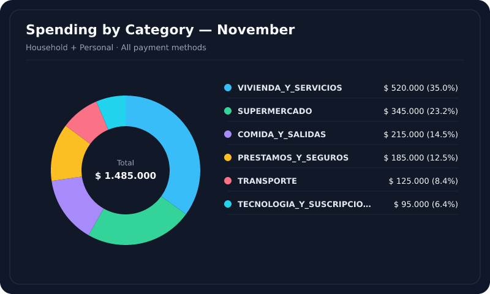
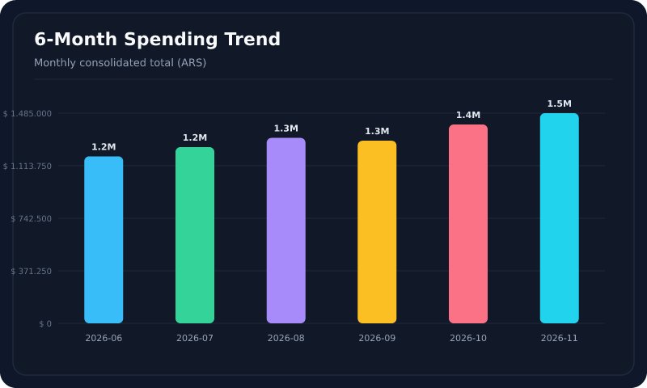
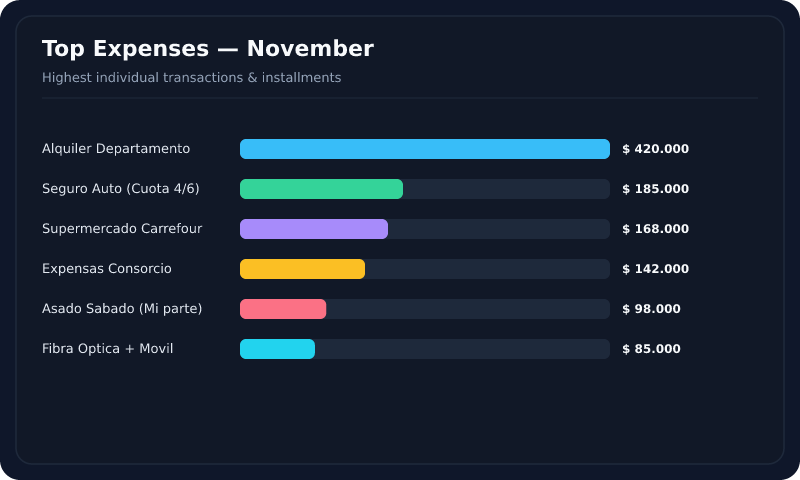
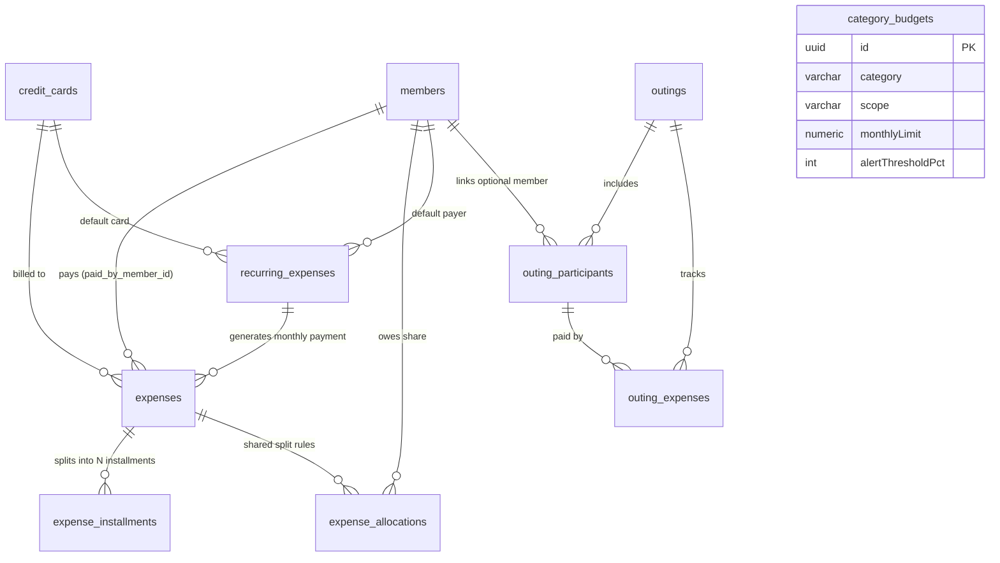

# Hermes Finance Stack

[](https://nestjs.com/)
[](https://www.postgresql.org/)
[](https://typeorm.io/)
[](https://docs.docker.com/compose/)
[](https://modelcontextprotocol.io/)
[](https://vitest.dev/)

> **Idioma / Language:** English · [Español (README.es.md)](README.es.md)  
> **Operations & Upgrades:** [docs/DEPLOYMENT.md](docs/DEPLOYMENT.md) · **Changelog:** [CHANGELOG.md](CHANGELOG.md) · **Latest Release:** [v2.0.2](docs/releases/v2.0.2.md)

**Self-hosted personal, household, and group finance platform operated entirely from Telegram.**  
Built on **NousResearch Hermes Agent**, a Clean Architecture **NestJS 12 + TypeORM** API exposing **43 Streamable HTTP MCP tools**, **PostgreSQL 18**, native **800×480 PNG chart rendering** (`@resvg/resvg-wasm`), and optional **Metabase BI** and **Paperless-ngx OCR** profiles.

[Why This Stack](#why-this-stack) · [Capabilities](#capabilities) · [Telegram Scenarios](#real-world-telegram-scenarios) · [Visual Charts](#native-png-charts) · [Architecture & Data Model](#architecture--data-model) · [Installation](#installation--setup) · [LLM & Costs](#llm-models--costs) · [Security](#security--privacy) · [API & MCP Reference](#complete-api--mcp-reference)

---

## Why This Stack

Most conversational finance bots rely on LLM memory, flat JSON files, or spreadsheets—which break down the moment you add credit card installments, card extensions, shared household splits, or inflation-adjusted recurring bills.

**Hermes Finance Stack** separates **natural-language understanding** from **financial accounting**:

| Design Principle | How It Works |
|---|---|
| **PostgreSQL 18 as Single Source of Truth** | Hermes runs with `memory_enabled: false`. Every read, write, balance, and settlement hits strongly-typed relational tables in PostgreSQL 18—zero LLM drift or forgotten entries. |
| **Deterministic Financial Math** | Installment schedules, extension card grouping, shared household splits, and minimal group debt transfers are computed in unit-tested TypeScript services—never left to LLM arithmetic. |
| **One Bot, Multiple People** | A single Hermes instance serves both 1:1 DMs and shared Telegram groups, identifying members automatically (`**User:**` in DMs, `[sender]` in groups) without deploying separate bots per person. |
| **Isolated Group Outings ("Salidas")** | Trips, dinners, and asados live in their own domain (`OutingsModule`) so ad-hoc friends never pollute household accounting—with one-command settlement and optional import of *your* share into personal expenses. |
| **Composable Docker Profiles** | Run only the lean 3-container core (`postgres`, `expenses-api`, `hermes-agent`), or enable `--profile metabase`, `--profile paperless`, or `--profile full` whenever you want BI dashboards or scanned-PDF OCR. |

---

## Capabilities

| Module | What It Handles |
|---|---|
| **Daily & Multimodal Expense Capture** | Natural-language text in Spanish/English, bank transfer screenshots (Vision preview + confirmation), digital PDFs (`read_file`), and scanned PDFs (optional Paperless-ngx OCR). |
| **Credit Cards, Installments & Extensions** | Full installment plans with automatic parent/child total recalculation, closing & due dates, `🏁` flags on final installments, and extension-card holder grouping (e.g., partner's extension billed to primary card). |
| **Multi-User & Household Shared Balances** | `PERSONAL` vs `SHARED` expense scopes, custom percentage allocations (`expense_allocations`), and minimal-transfer household settlement calculations. |
| **Group Outings ("Salidas")** | Splitwise-style group events managed collaboratively by multiple users *or* dictated by a single user for ad-hoc friends. Supports equal, subset (`splitBetween`), exact amount, and percentage splits. |
| **Fixed / Recurring Bills** | Monthly, bimonthly, and yearly templates (`recurring_expenses`) with *"what's still unpaid this month?"* tracking and inflation-friendly amount overrides at payment time. |
| **Category Budgets & Alerts** | Monthly caps per category and scope (`PERSONAL`, `SHARED`, `ALL`) with configurable alert thresholds surfaced automatically in summaries. |
| **Native PNG Charts & Exports** | Server-side SVG → PNG rendering (`@resvg/resvg-wasm`, 800×480 dark Slate cards) delivered directly in Telegram via `MEDIA:`, plus UTF-8 BOM CSV (Excel-ready) and JSON exports. |
| **Optional BI & Document Archive** | 15 calibrated SQL queries for **Metabase** ([`docs/metabase-queries.sql`](docs/metabase-queries.sql)) and asynchronous document archival/OCR via **Paperless-ngx**. |

---

## Real-World Telegram Scenarios

The bot uses **silent tool execution** (`👀` while working → `👍` on completion) and mobile-first formatting—no broken Markdown tables on narrow phone screens.

### 1. Daily Expense & Bank Transfers
```text
You:   Pagué 889 mil a BBVA con transferencia desde Galicia
Bot:   Listo ✅
       • 📅 23/11/2026  • 🏪 BBVA  • 💰 $889.000 ARS
       • 🏷️ PRESTAMOS_Y_SEGUROS · Variable  • 💳 Transferencia (Galicia)
```

### 2. Credit Card Installments & Extension Cards
```text
You:   Compré una notebook en 6 cuotas de 185k con la Visa Galicia (extensión de Sofía)
Bot:   Registrado ✅ (6 cuotas generadas)
       • 🏪 Notebook · 💰 $1.110.000 ($185.000 × 6)
       • 💳 Visa Galicia (Extensión: Sofía) · Primera cuota: Dic 2026
       • 🏁 Última cuota programada: May 2027
```

### 3. Group Outings ("Salidas") with Subset Splits
```text
You:   Armá la salida "Asado sábado" con Juan, Sofía y yo.
       Juan pagó 60k de carne y Sofía 30k de vino (el vino solo entre Juan y Sofía).
       ¿Cómo dividimos?
Bot:   🔥 Asado sábado — Total: $90.000
       • Juan: pagó $60.000 | le toca $35.000 (+$25.000)
       • Sofía: pagó $30.000 | le toca $35.000 (-$5.000)
       • Vos: pagó $0 | le toca $20.000 (-$20.000)

       💸 Transferencias mínimas:
       • Vos → Juan: $20.000
       • Sofía → Juan: $5.000

You:   Cerrá la salida y anotá mi parte en mis gastos
Bot:   Salida cerrada ✅ Se registró tu parte ($20.000) en COMIDA_Y_SALIDAS.
```

### 4. Fixed / Recurring Bills & Inflation Overrides
```text
You:   ¿Qué fijos faltan pagar este mes?
Bot:   📌 Gastos fijos pendientes (Noviembre):
       • Alquiler — est. $420.000 (vence día 10)
       • Fibra Óptica — est. $85.000 (vence día 18)

You:   Ya pagué Fibra Óptica, vino 92k con débito
Bot:   Pagado ✅ Fibra Óptica registrada por $92.000 (+8,2% vs estimado).
```

### 5. Category Budgets, Summaries & Exports
```text
You:   ¿Cómo vengo este mes con los presupuestos? Exportame el detalle en CSV
Bot:   📊 Resumen Noviembre — Total: $1.485.000
       • SUPERMERCADO: $345.000 / $350.000 (98,6% ⚠️ cerca del tope)
       • COMIDA_Y_SALIDAS: $215.000 / $200.000 (107,5% 🚨 excedido)
       [Delivers expenses-2026-11.csv directly in Telegram]
```

### 6. Receipt Screenshots & PDF Bills
- **Bank transfer / ticket photo (without caption)**: Hermes extracts merchant, date, amount, and payment method via Vision and shows a structured preview asking for confirmation before writing to PostgreSQL.
- **Digital PDF**: Read instantaneously with `read_file` (fast path).
- **Scanned PDF**: Automatically falls back to `extract_scanned_pdf_ocr` when `--profile paperless` is enabled.

---

## Native PNG Charts

All charts are rendered natively inside `expenses-api` with `@resvg/resvg-wasm` (no headless Chrome, no Puppeteer, zero external chart APIs) and delivered straight to Telegram:

| Category Breakdown (`by_category`) | 6-Month Trend (`monthly_trend`) |
|---|---|
|  |  |

| Top Expenses (`top_expenses`) | Also Supported |
|---|---|
|  | • `fixed_vs_variable` (Fixed vs Variable ratio)<br/>• `by_holder` (Spending grouped by cardholder / extension)<br/>• Custom period & currency formatting (`ARS`, `USD`, etc.) |

---

## Architecture & Data Model

### System Topology

```mermaid
flowchart LR
    TG["Telegram (DM / Group)<br/>Text · Screenshots · PDFs"] --> HERMES["Hermes Agent<br/>(Gateway + Vision + anydoc)"]
    HERMES -->|"Streamable HTTP<br/>POST /api/mcp (43 tools)"| API["NestJS 12 Backend"]
    HERMES -.->|"MEDIA:/opt/data/{charts,exports}"| TG

    subgraph API_MODS["NestJS 12 Clean Architecture Core"]
        direction TB
        M1["ExpensesModule<br/>7 REST Controllers · Charts · CSV/JSON"]
        M2["OutingsModule<br/>Group Events & Minimal-Transfer Engine"]
        M3["McpModule<br/>7 Domain Tool Registrars"]
    end

    API --- API_MODS
    API_MODS --> PG[("PostgreSQL 18<br/>10 Normalized Tables")]

    API_MODS -.->|"--profile paperless (optional)"| PL["Paperless-ngx<br/>Async Archival & OCR"]
    PG -.->|"--profile metabase (optional)"| MB["Metabase BI<br/>15 Calibrated SQL Queries"]
```



### PostgreSQL 18 Schema (10 Tables)



### MCP Request Lifecycle
1. User sends a message, photo, or PDF in Telegram (DM or Group).
2. Hermes Agent loads domain skills (`skills/finanzas/{facturas-ocr,monthly-summary-format,onboarding}`) and invokes the matching Streamable HTTP MCP tool(s) at `POST http://expenses-api:3000/api/mcp`.
3. NestJS validates payloads via `class-validator` / Zod schemas, executes transactional queries against PostgreSQL 18, and optionally writes PNG charts or CSV/JSON files to `/opt/data/{charts,exports}`.
4. Hermes replies in Telegram with concise mobile-friendly formatting and any `MEDIA:` attachment.

---

## Installation & Setup

### Prerequisites
- **Docker Engine** + **Docker Compose v2** (`docker compose version`)
- **OpenRouter API Key** ([openrouter.ai](https://openrouter.ai/)) — works with `openrouter/free` at `$0`
- **Telegram Bot Token** from `@BotFather`

### Option A — Interactive Wizard (Recommended)

```bash
git clone https://github.com/LucasMirandaD/hermes-finance-stack.git
cd hermes-finance-stack
chmod +x scripts/*.sh
./scripts/setup.sh
```

The wizard creates `.env`, prepares `hermes/{charts,exports}` with UID `1000:1000` permissions, lets you pick your Docker profile, starts the containers, and runs the end-to-end smoke test.

### Option B — Manual Docker Compose

```bash
git clone https://github.com/LucasMirandaD/hermes-finance-stack.git
cd hermes-finance-stack
mkdir -p hermes/charts hermes/exports
chown -R 1000:1000 hermes/charts hermes/exports 2>/dev/null || true

cp .env.example .env
# Edit .env: set OPENROUTER_API_KEY, TELEGRAM_BOT_TOKEN, and EXPENSES_DB_PASSWORD

docker compose up -d --build
./scripts/smoke-test.sh
```

### Modular Docker Profiles

Choose only the services you need. `health_check` automatically treats disabled optional profiles as `{ "enabled": false, "status": "disabled" }`:

| Profile | Command | Included Services & Ports |
|---|---|---|
| **Base** *(default)* | `docker compose up -d --build` | PostgreSQL 18, NestJS 12 API/MCP (`:3000`), Hermes Agent |
| **BI** | `docker compose --profile metabase up -d --build` | Base + Metabase (`:3005`, 15 queries in [`docs/metabase-queries.sql`](docs/metabase-queries.sql)) |
| **Docs / OCR** | `docker compose --profile paperless up -d --build` | Base + Paperless-ngx (`:8010`) + Redis 7 |
| **Full** | `docker compose --profile full up -d --build` | All services combined |

### First-Time Telegram Pairing & Guided Onboarding

1. If `TELEGRAM_ALLOWED_USERS` is left empty in `.env`, send any message to your bot on Telegram to receive a pairing code.
2. Approve your Telegram user on the host:
   ```bash
   docker exec hermes-agent hermes pairing approve telegram <CODE>
   ```
3. Send **"Empecemos"** to the bot—the built-in `onboarding` skill will walk you through adding household members, credit cards, fixed bills, and category budgets one question at a time.

> **Upgrading from v1.x or PostgreSQL 17?** See the step-by-step runbook (with automated `pg_dump` backups and `./scripts/migrate.sh`) in [docs/DEPLOYMENT.md](docs/DEPLOYMENT.md).

---

## LLM Models & Costs

Hermes Agent connects to OpenRouter (`hermes/config.yaml`), letting you switch models at any time without touching backend code:

| Tier | Model Example | Estimated Cost | Best For |
|---|---|---|---|
| **Free** *(default)* | `openrouter/free` | **$0 / month** | Getting started, daily text capture, MCP tool calling |
| **Low-Cost Production** | `google/gemini-2.5-flash` / `anthropic/claude-3.5-haiku` | ~$0.50–$2 / month | Fastest tool-calling accuracy + reliable receipt screenshot Vision |
| **High-Precision** | `anthropic/claude-sonnet-4` / `openai/gpt-4.1` | ~$3–$8 / month | Complex multi-item bills, long household group threads |

> **OpenRouter Free Tier Tip**: If `openrouter/free` returns HTTP `404`, enable `:free` endpoints in [OpenRouter Guardrails](https://openrouter.ai/workspaces/default/guardrails).

---

## Security & Privacy

- **100% Self-Hosted Financial Ledger**: All transactions, cards, installments, and household balances stay in your local PostgreSQL 18 volume—no third-party finance SaaS or bank credentials required.
- **Least-Privilege Containers**: `expenses-api` runs as non-root user `node` (`1000:1000`). `./hermes` is mounted read-only (`:ro`), with write access strictly scoped to `./hermes/charts` and `./hermes/exports`.
- **Telegram Access Control**: Only explicitly paired users or numeric IDs in `TELEGRAM_ALLOWED_USERS` can talk to the bot.
- **Zero Unstructured Memory Leakage**: Hermes runs with `memory_enabled: false`, ensuring financial records are never duplicated into opaque markdown memory files.
- **Environment Validation**: Startup fails fast via Joi schema validation (`backend/src/config/env.schema.ts`) if required database credentials are missing.

---

## Complete API & MCP Reference

### 43 MCP Tools (`POST /api/mcp`)

| Domain Registrar | Count | Tools |
|---|---|---|
| **Core & Health** | 7 | `health_check`, `register_expense`, `search_expenses`, `list_recent_expenses`, `update_expense`, `delete_expense`, `extract_scanned_pdf_ocr` |
| **Installments & Cards** | 8 | `get_upcoming_installments`, `get_monthly_installments_summary`, `search_pending_installments`, `pay_installment`, `update_installment`, `delete_installment`, `list_credit_cards`, `register_credit_card` |
| **Members & Shared** | 5 | `create_member`, `update_member`, `list_members`, `delete_member`, `get_shared_balance` |
| **Outings / Salidas** | 8 | `create_outing`, `list_outings`, `add_outing_participant`, `add_outing_expense`, `delete_outing_expense`, `get_outing_balance`, `settle_outing`, `delete_outing` |
| **Budgets** | 4 | `set_category_budget`, `list_category_budgets`, `delete_category_budget`, `get_budget_status` |
| **Fixed / Recurring** | 6 | `create_recurring_expense`, `list_recurring_expenses`, `update_recurring_expense`, `delete_recurring_expense`, `get_fixed_expenses_status`, `pay_recurring_expense` |
| **Analytics, Charts & Export** | 5 | `get_financial_summary`, `compare_months`, `top_expenses`, `export_expenses`, `render_chart` |

### Modular REST Controllers (`/api`)

| Controller | Base Route | Key Endpoints |
|---|---|---|
| `AppController` | `/api/health` | `GET /api/health` |
| `ExpensesController` | `/api/expenses` | `POST`, `GET`, `GET /search`, `GET\|PATCH\|DELETE /:id` |
| `InstallmentsController` | `/api/installments` | `GET /upcoming`, `GET /summary`, `GET /pending`, `POST /:id/pay`, `PATCH\|DELETE /:id` |
| `CreditCardsController` | `/api/credit-cards` | `GET`, `POST` |
| `MembersController` | `/api/members` | `GET`, `POST`, `GET /shared/balance`, `PATCH\|DELETE /:ref` |
| `BudgetsController` | `/api/budgets` | `GET`, `POST`, `GET /status`, `DELETE /:id` |
| `RecurringExpensesController` | `/api/recurring-expenses` | `GET`, `POST`, `GET /status`, `POST /:ref/pay`, `PATCH\|DELETE /:id` |
| `AnalyticsController` | `/api/analytics` | `GET /summary`, `GET /compare`, `GET /top`, `GET /export`, `GET /charts/render` |
| `OutingsController` | `/api/outings` | `POST`, `GET`, `GET /:ref/balance`, `POST /:ref/participants`, `POST /:ref/expenses`, `DELETE /expenses/:expenseId`, `POST /:ref/settle`, `DELETE /:ref` |

### Repository Layout & Local Testing

```text
hermes-finance-stack/
├── docker-compose.yml               # PostgreSQL 18 + NestJS 12 + Hermes + optional profiles
├── backend/                         # NestJS 12 Clean Architecture
│   ├── sql/                         # Idempotent PostgreSQL migrations (001, 002)
│   └── src/modules/
│       ├── expenses/                # 7 REST controllers, services, ChartService, ExportService
│       ├── outings/                 # OutingsController, OutingsService, split engine
│       └── mcp/                     # Streamable HTTP MCP server & 7 domain registrars
├── hermes/                          # Declarative Hermes config.yaml, SOUL.md & skills/finanzas/
├── docs/                            # DEPLOYMENT.md, metabase-queries.sql, assets/, releases/
└── scripts/                         # setup.sh, migrate.sh, smoke-test.sh
```

```bash
cd backend
pnpm install
pnpm test      # 42 Vitest unit tests across 9 suites
pnpm build
```

---

## Troubleshooting

- **`openrouter/free` returns 404**: Enable free model routing in [OpenRouter Guardrails](https://openrouter.ai/workspaces/default/guardrails).
- **Chart / export `EACCES` permission error**: Ensure `hermes/charts` and `hermes/exports` are owned by `1000:1000` (`chown -R 1000:1000 hermes/charts hermes/exports`).
- **Upgrading from PostgreSQL 17 to 18**: PostgreSQL 18 uses `/var/lib/postgresql` as its volume mount point and requires a `pg_dump` / `psql` restore from PG 17 clusters. Follow [docs/DEPLOYMENT.md](docs/DEPLOYMENT.md#5-upgrading-postgresql-17--postgresql-18).
- **Upgrading from v1.x with `DB_SYNCHRONIZE=false`**: Run `./scripts/migrate.sh --normalize-categories --backfill-owner "YourName"` (creates an automatic `pg_dump` backup first).
