# Hermes Finance Stack

[](https://nestjs.com/)
[](https://www.postgresql.org/)
[](https://docs.docker.com/compose/)
[](https://modelcontextprotocol.io/)
[](https://vitest.dev/)

> **Read in Spanish:** [README.es.md](README.es.md) · **Operations & Upgrades:** [docs/DEPLOYMENT.md](docs/DEPLOYMENT.md) · **Changelog:** [CHANGELOG.md](CHANGELOG.md)

Self-hosted personal, household, and group finance platform controlled entirely from Telegram. Built on **NousResearch Hermes Agent**, a modular **NestJS 12 + TypeORM** API exposing **43 Streamable HTTP MCP tools**, **PostgreSQL 17**, native **PNG chart generation**, and optional **Metabase BI** & **Paperless-ngx OCR** profiles.

---

## In Action (Telegram Showcase)

One Telegram bot handles direct messages and shared household groups with silent tool execution (`👀` → `👍`), structured confirmations, and mobile-first formatting (zero broken Markdown tables):

```text
You:   Pagué 889 mil a BBVA con transferencia desde Galicia
Bot:   Listo ✅
       • 📅 23/11/2026  • 🏪 BBVA  • 💰 $889.000 ARS
       • 🏷️ PRESTAMOS_Y_SEGUROS · Variable  • 💳 Transferencia (Galicia)

You:   Armá la salida "Asado sábado" con Juan, Sofía y yo.
       Juan pagó 60k de carne y Sofía 30k de vino (el vino solo entre Juan y Sofía).
       ¿Cómo dividimos?
Bot:   🔥 Asado sábado — Total: $90.000
       • Juan: pagó $60.000 | le toca $35.000 (+$25.000)
       • Sofía: pagó $30.000 | le toca $35.000 (-$5.000)
       • Vos: pagó $0 | le toca $20.000 (-$20.000)

       💸 Transferencias mínimas:
       • Vos → Juan: $20.000
       • Sofía → Juan: $5.000

You:   Mandame un gráfico de gastos por categoría de este mes
Bot:   [Delivers 800×480 PNG donut chart directly in Telegram]
```

*(Also supports forwarding bank transfer screenshots for automatic field extraction and digital/scanned PDF bills with installment schedules.)*

---

## Architecture

PostgreSQL is the single source of truth (`memory_enabled: false` in Hermes). Every business rule lives in typed TypeScript services exposed over Streamable HTTP MCP and modular REST controllers.

```mermaid
flowchart LR
    TG["Telegram (DM / Group)<br/>Text · Screenshots · PDFs"] --> HERMES["Hermes Agent<br/>(Gateway + Vision + anydoc)"]
    HERMES -->|"Streamable HTTP<br/>POST /api/mcp (43 tools)"| API["NestJS 12 Backend"]
    HERMES -.->|"MEDIA:/opt/data/{charts,exports}"| TG

    subgraph API_MODS["NestJS 12 Modular Core"]
        direction TB
        M1["ExpensesModule<br/>7 REST Controllers + Charts + CSV/JSON"]
        M2["OutingsModule<br/>Group Events & Split Engine"]
        M3["McpModule<br/>7 Domain Tool Registrars"]
    end

    API --- API_MODS
    API_MODS --> PG[("PostgreSQL 17<br/>10 Tables")]

    API_MODS -.->|"--profile paperless (optional)"| PL["Paperless-ngx<br/>Async Archival & OCR"]
    PG -.->|"--profile metabase (optional)"| MB["Metabase BI<br/>15 Calibrated SQL Queries"]
```



---

## Core Capabilities

- **Single-Hermes Multi-User & Shared Balances**: One bot identifies each member automatically (`**User:**` in DMs, `[sender]` in groups), separates `PERSONAL` vs `SHARED` spending with custom `%` allocations, and computes minimal household settlements.
- **Group Outings ("Salidas")**: Isolated Splitwise-style tracking for trips, dinners, and asados. Managed by multiple users or dictated by a single user for ad-hoc friends, supporting equal, subset (`splitBetween`), exact, or percentage splits—plus optional recording of your own share into personal expenses upon closing.
- **Fixed / Recurring Bills**: Monthly, bimonthly, or yearly templates (`recurring_expenses`) with *"what's still unpaid this month?"* checks and inflation-friendly amount overrides on payment.
- **Installments & Credit Card Extensions**: Full installment plans with automatic parent/child recalculation, card closing/due dates, and extension holder grouping (`🏁` flags on finishing installments).
- **Category Budgets & Alerts**: Monthly caps per category/scope with configurable warning thresholds surfaced automatically in financial summaries.
- **Multimodal Receipts, PNG Charts & Exports**: Fast digital PDF parsing (`read_file`), vision previews for uncaptioned screenshots, 800×480 PNG charts (`@resvg/resvg-wasm`), and UTF-8 BOM CSV / JSON exports.

---

## Quick Launch

Requires **Docker Engine + Compose v2**, an **OpenRouter API key** (supports `openrouter/free` at `$0`), and a **Telegram Bot token** from `@BotFather`.

```bash
git clone https://github.com/LucasMirandaD/hermes-finance-stack.git
cd hermes-finance-stack
chmod +x scripts/*.sh
./scripts/setup.sh
```

Or launch directly with Docker Compose:

```bash
cp .env.example .env    # Configure OPENROUTER_API_KEY, TELEGRAM_BOT_TOKEN, EXPENSES_DB_PASSWORD
docker compose up -d --build
./scripts/smoke-test.sh
```

### Modular Docker Profiles

Pick only the components you need—`health_check` automatically treats disabled optional profiles cleanly (`status: "disabled"`):

| Profile | Command | Included Services |
|---|---|---|
| **Base** | `docker compose up -d --build` | PostgreSQL 17, NestJS 12 API/MCP (`:3000`), Hermes Agent |
| **BI** | `docker compose --profile metabase up -d --build` | Base + Metabase (`:3005`, 15 queries in [`docs/metabase-queries.sql`](docs/metabase-queries.sql)) |
| **Docs/OCR** | `docker compose --profile paperless up -d --build` | Base + Paperless-ngx (`:8010`) + Redis |
| **Full** | `docker compose --profile full up -d --build` | All services combined |

First-time Telegram pairing (when `TELEGRAM_ALLOWED_USERS` is empty): message your bot, approve the code via `docker exec hermes-agent hermes pairing approve telegram <CODE>`, then send **"Empecemos"** to run the guided onboarding skill.

---

## API & MCP Reference

<details>
<summary><strong>43 MCP Tools (POST /api/mcp)</strong></summary>

| Domain | Tools |
|---|---|
| **Core & Health (7)** | `health_check`, `register_expense`, `search_expenses`, `list_recent_expenses`, `update_expense`, `delete_expense`, `extract_scanned_pdf_ocr` |
| **Installments & Cards (8)** | `get_upcoming_installments`, `get_monthly_installments_summary`, `search_pending_installments`, `pay_installment`, `update_installment`, `delete_installment`, `list_credit_cards`, `register_credit_card` |
| **Members & Shared (5)** | `create_member`, `update_member`, `list_members`, `delete_member`, `get_shared_balance` |
| **Outings / Salidas (8)** | `create_outing`, `list_outings`, `add_outing_participant`, `add_outing_expense`, `delete_outing_expense`, `get_outing_balance`, `settle_outing`, `delete_outing` |
| **Budgets (4)** | `set_category_budget`, `list_category_budgets`, `delete_category_budget`, `get_budget_status` |
| **Fixed / Recurring (6)** | `create_recurring_expense`, `list_recurring_expenses`, `update_recurring_expense`, `delete_recurring_expense`, `get_fixed_expenses_status`, `pay_recurring_expense` |
| **Analytics, Charts & Export (5)** | `get_financial_summary`, `compare_months`, `top_expenses`, `export_expenses`, `render_chart` |

</details>

<details>
<summary><strong>Modular REST Controllers (/api)</strong></summary>

- `GET /api/health` (`AppController`)
- `/api/expenses` — `POST`, `GET`, `GET /search`, `GET|PATCH|DELETE /:id`
- `/api/installments` — `GET /upcoming`, `GET /summary`, `GET /pending`, `POST /:id/pay`, `PATCH|DELETE /:id`
- `/api/credit-cards` — `GET`, `POST`
- `/api/members` — `GET`, `POST`, `GET /shared/balance`, `PATCH|DELETE /:ref`
- `/api/budgets` — `GET`, `POST`, `GET /status`, `DELETE /:id`
- `/api/recurring-expenses` — `GET`, `POST`, `GET /status`, `POST /:ref/pay`, `PATCH|DELETE /:id`
- `/api/analytics` — `GET /summary`, `GET /compare`, `GET /top`, `GET /export`, `GET /charts/render`
- `/api/outings` — `POST`, `GET`, `GET /:ref/balance`, `POST /:ref/participants`, `POST /:ref/expenses`, `DELETE /expenses/:expenseId`, `POST /:ref/settle`, `DELETE /:ref`

</details>

<details>
<summary><strong>Project Layout & Local Development</strong></summary>

```text
hermes-finance-stack/
├── docker-compose.yml               # Base + optional metabase, paperless, full profiles
├── backend/                         # NestJS 12 Clean Architecture (Expenses, Outings, MCP)
│   ├── sql/                         # Idempotent PostgreSQL migrations (001, 002)
│   └── src/modules/{expenses,outings,mcp}/
├── hermes/                          # Declarative Hermes Agent config, SOUL.md & skills/finanzas/
├── docs/                            # DEPLOYMENT.md, metabase-queries.sql, releases/
└── scripts/                         # setup.sh, migrate.sh, smoke-test.sh
```

```bash
cd backend
pnpm install
pnpm test      # 38 Vitest unit tests across 9 suites
pnpm build
```

</details>

<details>
<summary><strong>Quick Troubleshooting</strong></summary>

- **OpenRouter `openrouter/free` returns 404**: Enable `:free` endpoints in [OpenRouter Guardrails](https://openrouter.ai/workspaces/default/guardrails).
- **Upgrading from v1.x with `DB_SYNCHRONIZE=false`**: Run `./scripts/migrate.sh --normalize-categories --backfill-owner "YourName"` (creates an automatic `pg_dump` backup first).
- **Chart/export `EACCES` permissions**: Ensure `hermes/charts` and `hermes/exports` are owned by `1000:1000` (`HERMES_UID:HERMES_GID`).
- **Full operations guide**: See [docs/DEPLOYMENT.md](docs/DEPLOYMENT.md).

</details>
